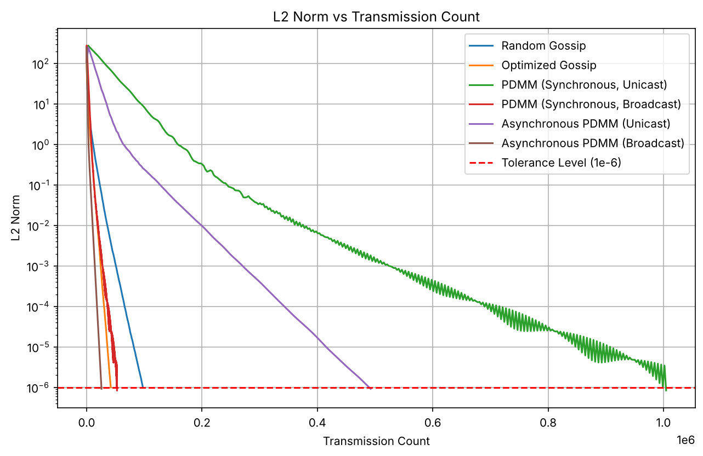

# Distributed Signal Processing: Gossip vs. PDMM Consensus

Decentralised **average and median consensus** in a wireless sensor network, implemented from scratch in Python.
Each sensor measures a local temperature and talks only to neighbours within its radio range. The goal is for
every node to agree on the network-wide average (or median) with as few radio transmissions as possible.



*150 sensors in a 100 × 100 field, communication radius 20 (random geometric graph, 2 862 edges). Error is
‖x − x̄·1‖₂ across all nodes; the dashed line is the 10⁻⁶ stopping tolerance. Reproduce with
`SAVE_FIGS=1 SEED=0 python combined.py`.*

## What's implemented

| Algorithm | Files | Notes |
| --- | --- | --- |
| Randomised gossip | `Random_Gossip.py`, `combined_algos.py` | Uniform random neighbour pairs |
| Optimised gossip | `Random_Gossip.py`, `combined_algos.py` | Transition matrix **P** found with CVXPY by minimising the second-largest eigenvalue of E[W] |
| PDMM, synchronous | `PDMM.py`, `combined_algos.py` | Primal-dual method of multipliers, unicast and broadcast variants |
| PDMM, asynchronous | `Async_PDMM.py`, `combined_algos.py` | One node activates at a time |
| Median consensus via PDMM | `PDMM_median.py`, `Median_asyn_PDMM.py`, `combined_median.py` | ℓ₁ (median) objective instead of ℓ₂ (mean) |
| Robustness to packet loss | `*_tf.py` | Same algorithms with a configurable transmission-failure rate |

`preprocessing.py` holds the shared utilities: the synthetic temperature field, the random geometric graph,
connectivity checks via the Laplacian spectrum, and the minimum sensor count for connectivity with high
probability (r² ≥ 2 log n / n).

## Results (seed 0, tolerance 10⁻⁶)

| Method | Iterations | Transmissions |
| --- | ---: | ---: |
| Random gossip | 48 790 | 97 582 |
| Optimised gossip | 20 941 | 41 884 |
| PDMM, synchronous unicast | 350 | 1 004 562 |
| PDMM, synchronous broadcast | 350 | 52 650 |
| PDMM, asynchronous unicast | 171 | 492 264 |
| **PDMM, asynchronous broadcast** | **171** | **25 800** |

Takeaways: optimising the gossip probabilities more than halves the communication cost. PDMM converges in
far fewer iterations, but it only pays off in transmissions once it uses the broadcast nature of the wireless
channel. Asynchronous broadcast PDMM was the cheapest overall.

## Running

```bash
pip install -r requirements.txt

python combined.py               # average consensus: all six methods
python combined_median_plots.py  # median consensus
python Random_Gossip_tf.py       # packet-loss experiments (also PDMM_tf.py, PDMM_Asyn_tf.py)
```

Set `SAVE_FIGS=1` to write figures to `figures/` instead of opening windows, and `SEED=<int>` to fix the
random network.

## Context

Course project for Distributed Signal Processing, MSc Electrical Engineering (Signals & Systems), TU Delft.
